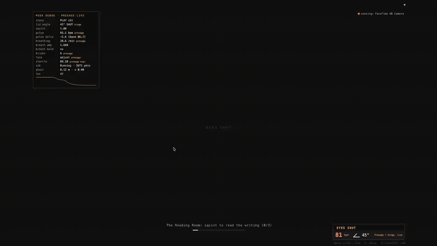
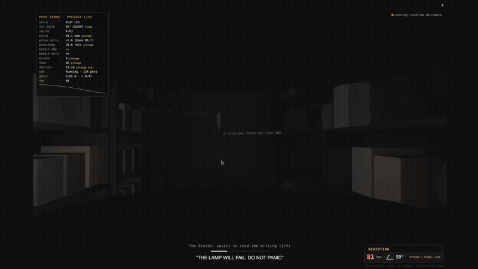
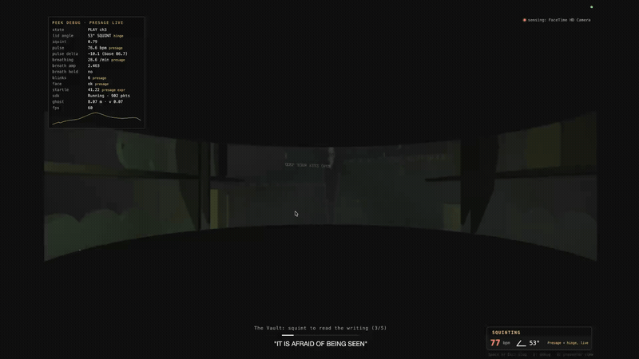
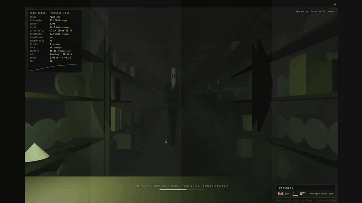
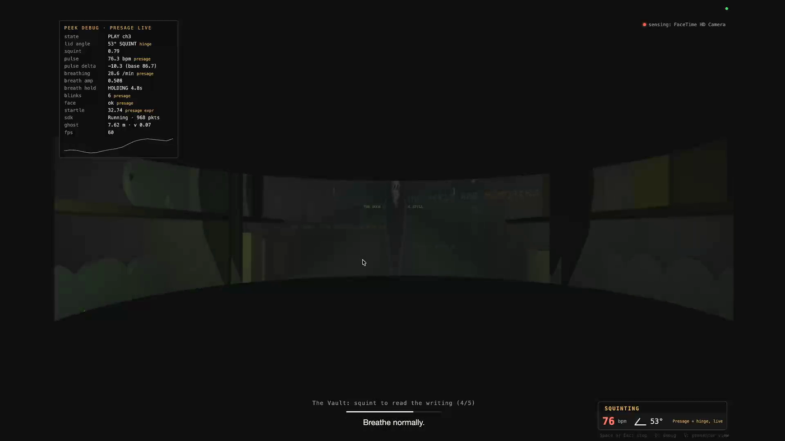

<!--
Before publishing:
1. Make the GitHub repo public (the GIF links below point at it).
2. Upload recordings/peek-demo.mp4 to YouTube (unlisted is fine) and paste the link in Demo.
3. Upload the agent session, make it public, paste the link in Agent Session.
4. Replace TODO_DEV_USERNAME.
Rules: keep the template headings in this order. No health claims.
-->

*This is a submission for the [Presage SmartSpectra SDK Challenge](https://dev.to/challenges/presage-2026-11-04)*

## What I Built



**Peek is a horror game where your MacBook lid is your eyelids.**

You sit in a dark archive. Something tall stands at the end of the aisle. I call it the Archivist. While you look at it, it can't move.

You can't just stare, though. The walls have writing on them, and you can only read it by squinting. Squinting means tilting the lid down. Tilt it further and your eyes are shut: the screen goes black and you hear it coming. It moves when you blink. It gets faster when your pulse goes up. Holding your breath makes it lose you, for a few seconds.

You get out by doing the hard thing: open your eyes, look at it, and calm down until your pulse is back near your resting rate. Then the lights come on.

Most horror games are about looking away. I wanted looking away to be something you do with your hands. M2 and newer MacBooks have an angle sensor in the hinge, and it makes a surprisingly good eyelid.

There are three chapters:

| Chapter | What changes |
|---|---|
| 1. The Reading Room | You learn the rules. 3 messages to find |
| 2. The Stacks | The lamp dies on a schedule. The bulb buzzes first, and in the dark you can't watch it. 4 messages |
| 3. The Vault | It moves somewhere new every time you shut your eyes. 5 messages |

The twelve messages tell the Archivist's story. One full session, with calibration, takes about 8 minutes.

**Where the idea came from.** [Nevermind](https://store.steampowered.com/app/342260/Nevermind/) (2015) got harder as your heart rate went up, so I knew pulse-driven horror could work. Sam Henri Gold's [LidAngleSensor](https://github.com/samhenrigold/LidAngleSensor) showed the hinge angle can be read at all. I haven't seen the two put together: the lid as eyelids, a blink as the monster's cue to move, and holding your breath to hide.

## Demo



This is one full live session, cut down to under 3 minutes. Presage reads me through the MacBook's built-in camera. The panel in the top left is Peek's debug overlay: raw Presage values (pulse, breathing, blinks, face status, packet count) next to the hinge angle and the ghost's distance. The strip in the bottom right shows the lid zone, my pulse and the hinge angle as I play.

The lamp dies in chapter 2. In the dark you can't watch it, so it moves:



Holding my breath while it was close. The overlay shows the hold being detected, and after a few seconds the game tells me to breathe normally:



The way out: look straight at it and let your pulse come down.



## Code



```bash
git clone https://github.com/Labreo/peek.git && cd peek
npm install
cp .env.example .env   # add your free Presage key: PRESAGE_API_KEY=...
npm start              # the lid needs an M2 or newer MacBook; the arrow keys work otherwise
npm run replay         # no camera, no key, no lid: watch a recorded run
```

The README covers the requirements, the camera setup and troubleshooting. `npm run replay` plays a recorded run through the same signal code and game rules at a fixed 30 Hz step. It lets you see the game without the hardware, and it doubles as a test: the same file always gives the same ending.

## How It Responds to Human Signals



Peek uses three live Presage signals, plus a fourth for looks, and the hinge sensor:

| Signal | Source | What it does | Handling |
|---|---|---|---|
| Lid angle | MacBook hinge sensor, read 30 times a second | Open: you are watching and it can't move. Squint: the writing shows but it creeps. Shut: black screen and it rushes in | Median of 5 samples and 3 degrees of hysteresis, so the zone doesn't flicker at the boundary |
| Blink | Presage `BLINKING` | Each blink while you watch lets it step 25 cm closer | Counted on the rising edge with a 250 ms gap, so one blink is one step |
| Pulse | Presage `PULSE_RATE` | The further you are above your own resting pulse, the faster it moves. To win, stay within 3 bpm of resting for 8 s (12 s in chapter 3) | Only readings Presage marks stable are used, smoothed with a moving average. Pulse is slow, so it sets the pressure, not the reflexes |
| Breathing | Presage breathing trace (`upperTrace`) | Hold your breath when it is within 3 m and it loses you and drifts back | The trace's swing over 3 s has to drop below 20% of your calm swing for 1 s. Hiding then lasts 4 s at most, so a hold never needs to go much past 8 s |
| Expression | Presage `EXPRESSIONS` | A scared or surprised face makes the desk lamp stutter | Looks only. It never changes the rules |

**The ghost's rules.** It starts 10 m away and catches you at 0.8 m. While the lid is open and you don't blink, it stays put, and if you hold a calm, unbroken gaze it backs off. While you squint it creeps at 5 cm/s, plus up to 15 cm/s more if your pulse is up. With your eyes shut it comes at 40 to 80 cm/s, depending on your pulse.

So you need to squint to find the messages, but squinting lets it creep. Shutting your eyes feels safe and is the worst thing you can do. And the more scared you get, the faster it comes.

**Everything is relative to you.** Before play, a 60 s calm scene records your resting pulse and normal breathing. A 15 s lid calibration records your open angle and how far down you squint. In the run in the video, my resting pulse came out at 86.7 bpm. I was nervous about recording. By the final steady-up in chapter 3 the stable readings were down around 60 to 61 bpm.

**The integration.** Presage runs natively in Electron's main process ([`src/main/presage.ts`](https://github.com/Labreo/peek/blob/main/src/main/presage.ts)). The window only receives metrics packets:

```ts
const sdk = new ss.SmartSpectraSDK({
  apiKey: this.apiKey,
  requestedMetrics: [...ss.breathingMetrics, ss.MetricType.PULSE_RATE, ss.MetricType.BLINKING, ss.MetricType.EXPRESSIONS],
  enableTelemetry: false, // Peek opts out of Presage's optional SDK telemetry
});
sdk.on('metrics', (buf, ts) => this.send({ type: 'metrics', buf: new Uint8Array(buf), ts })); // -> signal bus
sdk.useCamera(ss.CameraSelection.byId(cameraId), { width: 1280, height: 720, fps: 30 });
sdk.start();
```

The renderer decodes each packet with `decodeMetrics` from `@smartspectra/node-sdk/messages`, turns it into timestamped events, and the signal bus filters them before the game rules see them.

**What went wrong along the way.**

- **The camera problem is the whole game.** With the built-in camera, lowering the lid points the camera at the keyboard. So Peek lets you pick any camera. A phone in USB webcam mode (I used a Pixel 8a) or an external webcam sits beside the laptop and doesn't care where the lid is. The video uses the MacBook camera because it was the simplest way to film. So when the lid goes down, Peek keeps your last pulse and doesn't pause until you open it again. With a separate camera, sensing doesn't depend on the lid at all.
- **Frame rate.** My first version used Presage's renderer helper, which sends every camera frame from the window to the main process. With the 3D scene running on a MacBook Air, Presage stopped with "frame rate too low" (error 14). Capturing the camera natively in the main process fixed it.
- **One camera, one reader.** Opening the sensing camera anywhere else at the same time, even for a small preview, broke Presage's frame timing (error 11). Now nothing else opens it.
- **Blinks were too strong.** At 50 cm per blink, normal blinking ended every run in about two minutes. I dropped it to 25 cm and made a calm gaze push the ghost back.
- **Still rough:** with the built-in camera Presage often asks you to adjust your position, and in this run it reported "ok" for a little over half of the play time. Every time it lost my face for 3 s with the lid open, the game paused. I cut those pauses out of the video.

## Prize Categories

**Most Creative or Delightful Use.** The laptop hinge becomes an eyelid, and each Presage signal causes a different scare: blinks move the monster, your pulse sets its speed, and holding your breath hides you. The only way to win is the opposite of what fear makes you do: keep your eyes open and calm down.

## Consent and Data Handling

- **Consent:** a plain-language consent card appears before the camera is touched. The camera starts only after "I agree, start camera". A camera-on indicator stays in the corner the whole time.
- **Processing:** the SmartSpectra SDK processes the video on the player's own computer. Peek never records or saves video, and never asks the SDK for image output.
- **Storage:** readings stay in memory for the session.
- **Sharing:** none. Peek uploads nothing.
- **Retention:** readings are cleared when you quit. A run file is written only if you press "Save run file" on the debrief screen, and only to `~/Documents/Peek/runs/` on your computer.
- **Deletion:** quitting clears memory. "Delete my data" on the debrief screen clears the session and deletes every run file Peek has written.
- **SDK telemetry:** off, with `enableTelemetry: false`. Presage's [Telemetry and Privacy doc](https://github.com/Presage-Security/SmartSpectra/blob/main/docs/telemetry-and-privacy.md) says that when it is disabled, "the SDK starts no telemetry session and transmits nothing." The SDK still contacts Presage's servers to check the API key.
- **AI services:** none.
- **Who is measured:** only the person at the computer. The debrief is a game recap. It is not health information.
- **Safety:** a content note before play. Flashing can be turned off. One jump scare per run, under 1.5 s with the volume capped. A breath hold stops working after about 8 s and the game says "Breathe normally". No mechanic rewards a higher heart rate. Space or Esc stops the game at any time.

## Agent Session

I built Peek with Claude Code. The idea and the playtesting were mine. Claude wrote most of the code with me, and I reviewed and tested it on my own MacBook.



Built solo by TODO_DEV_USERNAME.
